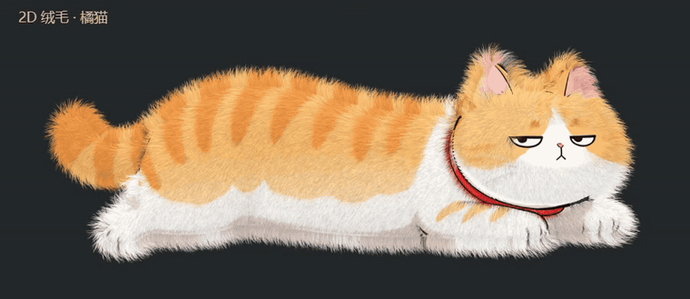

# cat-fur · 2D 猫咪绒毛

在原有 2D 插画上绘制细密、柔软的毛丝。默认展示橘猫特写，可切换整张图集；鼠标划过时毛根保持固定，毛梢弯曲，离开后逐渐回弹。



*实时录制：身体毛流起伏、轮廓绒毛和固定毛根。*

## 运行

直接双击 `index.html`，或在本目录启动静态服务器：

```sh
python -m http.server 8734
```

打开 `http://127.0.0.1:8734/`。默认原图、法线和高度贴图都已嵌入网页，不依赖外部网络或构建工具。浏览器需支持 WebGL2，建议开启硬件加速。

## 交互

- **细软绒毛 / 蓬松长绒**：两套预设，也可调整毛长、浓密程度、风力和抚摸力度。
- **重力 · 向下垂落**：独立调节下垂程度；风力归零可单独观察。长绒的脸侧、胸口和尾部更明显。
- **毛丝柔和度**：默认 80%。对细毛做像素覆盖率抗锯齿，减少细毛边缘闪烁；设为 0% 可对比未柔化的毛丝，不会模糊原画。
- **毛发层次**：默认 75%。独立控制逐根毛丝的明暗差与根梢渐变；提高可让身体内部的毛流更清晰，不会关闭抗锯齿。
- **风力 / 风向**：整片毛发沿所选的左、右方向随阵风弯曲。风力 0% 时停止风吹，100% 时明显摆动。系统偏好减少动态效果时默认风力为 0%，主动调节仍可开启。
- **查看原图**：切换原画与毛发效果，不改动参数。
- **重新长毛 / 生长进度**：从原图平滑生长，进度为 0 时与原图完全一致。
- **预览范围**：橘猫特写或完整图集。
- **贴图增强**：默认开启，关闭即可对比原有毛流；法线和高度影响可分别调至 0–100%。两个影响都为 0 时与关闭增强一致。
- **换一张图 / 拖入图片**：透明 PNG、WebP 保留透明通道；纯色底图片尝试从边缘分割背景。
- **恢复默认**：回到橘猫、细软绒毛和初始参数。
- **深灰 / 暖白底色**：方便检查浅色毛梢与轮廓。

## 渲染

CPU 根据真实透明轮廓计算距离场，一次生成每根毛的根坐标、方向、颜色和随机参数。GPU 通过实例化曲线条带绘制收尖的毛丝；重力、风与鼠标只改变曲线，不重新生成毛根。密度变化只显隐固定的毛丝。

风使用统一的屏幕方向和连续阵风，重力始终向下。外力在毛流垂线上的分量改变弯曲角，六段等长曲线保持毛长，避免强风拉伸或缩短毛丝；总长限制在 72 像素内，位于 84 像素透明边距之内。风力为零时不再有随时间变化的扰动。

身体内部毛丝另外响应沿风向传播的连续起伏，使与风平行的毛流也能抬起、落下；这部分只影响身体长毛，不扰动轮廓底绒。毛根固定，关闭风力后起伏完全停止。

毛丝透明度采用高斯截面在像素投影范围内的积分近似，并扩展条带以覆盖滤波边缘。滤波范围由毛丝横向法线与宽度计算，替代单点采样。毛发层次单独控制固定的逐根明暗差与连续根梢渐变，避免柔化时把身体内部毛流压平。Canvas 关闭额外 MSAA，避免与透明覆盖率叠加时的微小静帧差异。没有整屏模糊或历史帧混合，原画单独绘制，风吹和抚摸不依赖历史画面。

身体使用连续的 2D 毛流，轮廓混合朝外的方向。毛色取自原图内部，避开轮廓墨线；半透明原图与毛丝采用统一的预乘 Alpha 混合。默认图集另有五官、项圈和服装区域遮罩。

轮廓交界增加短密底绒，毛根位于身体内部、位于长毛下方，对风和抚摸只作轻微响应。默认图的近边缘身体毛丝向内取色，避免把原画浅色描边复制成白缝；原图对比仍使用未经修改的图片。底绒同样遵守生长进度、密度和保护遮罩。

原始 `cats.png`、`cats.jpg`、`nrm.jpg`、`hgt.jpg` 保留不变，实际使用 `cats.png` 的透明通道和配套的两张数据贴图：

- **法线 `nrm.jpg`**：在固定毛根附近平滑采样，翻转绿色通道以适配向下的画布 Y 轴。只轻量辅助原有毛流，并用于左上方的柔和光照；不会改变毛根位置或取代原图轮廓。
- **高度 `hgt.jpg`**：在同一毛根位置采样，在 0.85–1.18 倍范围内调节毛长，同时加入轻微毛根阴影。默认影响为 65%；这张贴图含原画明暗信息，因此限制变化幅度。
- 两张贴图实际为 `1400×1749`，通过归一化图集坐标对齐 `1400×1730` 参考坐标；特写与整图使用同一坐标规则。无效采样保持原效果，自选图片没有配套贴图时自动禁用增强。

## 验证

`browser-tests/smoke.cjs`、`browser-tests/maps.cjs`、`browser-tests/dynamics.cjs` 和 `browser-tests/smoothing.cjs` 使用真实 Chromium、图像像素比较和上传样例检查：

- 毛发开关、生长进度和原图一致性。
- 抚摸变形及离开后的恢复。
- 透明边距、黑色主体、少量透明像素、半透明颜色。
- 预设、图集、底色、窄屏布局与错误图片恢复。
- 浏览器异常与资源加载错误。
- 法线、高度分别产生实际像素变化，开关与归零对比一致。
- 无配套贴图的上传回退、图集切换和隔离单 HTML 的离线贴图加载。
- 实际 GPU 曲线的毛根固定、毛长限制、重力下垂和左右风向；静风、连续阵风、最大参数边界，以及减少动态偏好下的手动开启。
- 柔化前后的身体高频明暗、毛丝亚像素平移时的覆盖率稳定性和平均覆盖率、开关精确恢复，以及原画逐像素不变。隔离测试直接运行正式顶点与片元着色器。

先启动上面的静态服务器，再运行：

```sh
cd browser-tests
npm install
npx playwright install chromium
npm test
```

可通过 `PW_BASE_URL` 指定预览地址，通过 `PW_EXECUTABLE_PATH` 指定 Chromium 路径。可用 `npm run test:maps` 单独检查贴图、`npm run test:dynamics` 检查重力和风，或 `npm run test:smoothing` 检查毛丝柔化。测试报告、截图和浏览器追踪保存在 `browser-tests/test-output/`。

## 边界

- 纯色底分割不支持复杂照片抠图，优先使用透明图片。
- 自选图片没有语义材质信息，深色绘制细节会受到保护，但不能自动识别衣服和五官；图集服装遮罩仅适用于自带素材。
- 目前不提供自选法线/高度文件入口，配套贴图增强仅应用于默认猫咪图集。
- 毛发参数受工作分辨率与显示缩放影响；不同设备的帧率取决于 GPU 和浏览器硬件加速。
- 整图集的材质区域采用保守的手工范围，少数不明确的边缘不生毛。
